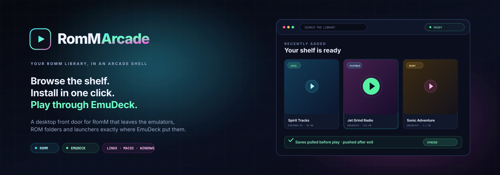
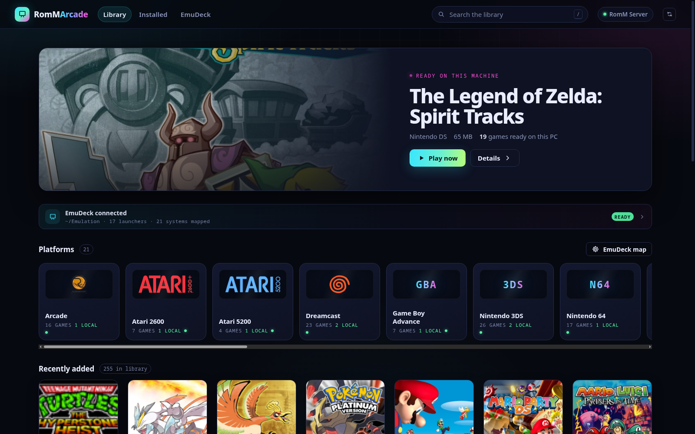
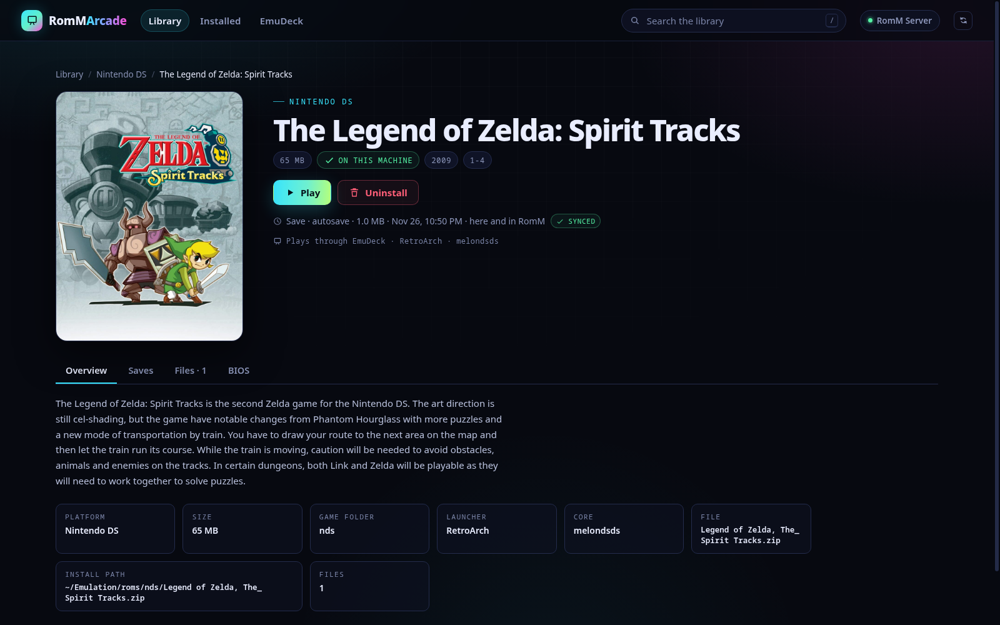
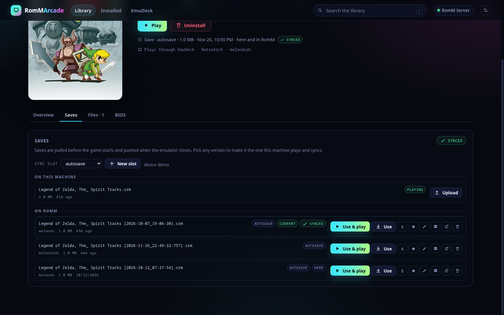
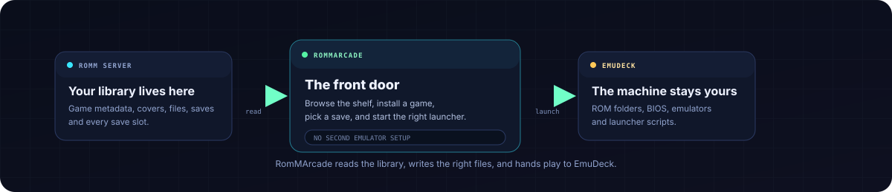

# RomMArcade

<p align="center">
  
</p>

<p align="center">
  <b>Your RomM library, in an arcade shell.</b><br>
  Browse the shelf. Install in one click. Play through the EmuDeck machine you already set up.
</p>

<p align="center">
  <a href="https://github.com/jkoehler11/RomMArcade/releases"></a>
  
  
  
  <a href="LICENSE"></a>
</p>

<p align="center">
  <a href="#quick-start">Quick start</a> ·
  <a href="#what-it-does">What it does</a> ·
  <a href="#saves">Saves</a> ·
  <a href="#documentation">Documentation</a>
</p>

RomM is the library. EmuDeck is the machine that knows how to play. RomMArcade is the front door
between them: a native desktop app that makes your RomM collection feel like a shelf instead of a
server directory.

It doesn't configure a second set of emulators. It uses the ROM folders, BIOS and launcher scripts
EmuDeck already owns, so the setup you have is the setup that plays.

## What it does

- **A library built for the couch.** Platform rails, cover art, search, install state and a game
  page that tells you exactly what will open the game.
- **One-click installs.** Games land in the right EmuDeck folder. Multi-file games become one
  folder. Downloads show live progress and can start playing when they finish.
- **EmuDeck stays in charge.** RomMArcade never installs or updates emulators behind your back.
  It finds the launcher EmuDeck wrote and hands it the right ROM and core.
- **Saves before and after play.** Pull the latest save before the emulator starts, push the new
  one when it closes, and stop rather than choose a winner when both sides changed.
- **A real game page.** Every version on RomM, every save on this machine, the launcher, the core,
  the file and the install path — all visible before you press Play.
- **Links that work.** Open, install and play from a browser, a desktop shortcut, or RomM's own
  Play menu with the companion plugin.
- **No EmuDeck? Still a library.** Mirror your server's folder layout or choose your own. Install
  and manage games now; add EmuDeck whenever you're ready.

## A look around

<p align="center">
  
  <br>
  <sub>The library: one shelf for every platform on your RomM server.</sub>
</p>

| A game, with everything visible | Saves, without the guesswork |
| --- | --- |
|  |  |
| Launcher, core, file and save state in one place. | Pick any version; **Use & play** makes it the one this machine plays and syncs. |

## How it fits

<p align="center">
  
</p>

RomMArcade reads your library and saves from RomM, then writes the game into EmuDeck's folders and
starts the matching EmuDeck launcher. Nothing is installed twice and nothing is configured twice.

## Quick start

### 1. Install

Prebuilt builds are on the [Releases](https://github.com/jkoehler11/RomMArcade/releases) page.

| Platform | Install |
| --- | --- |
| **Linux** | Run the `.AppImage` after `chmod +x`. Needs WebKitGTK 4.1 and PyGObject. |
| **macOS** | Open the `.pkg`. The build is unsigned, so right-click → **Open** the first time. |
| **Windows** | Run the `-setup.exe`. SmartScreen may warn because the build is unsigned. |

On Arch Linux, the Linux runtime dependencies are:

```bash
sudo pacman -S webkit2gtk-4.1 python-gobject
```

Building from source is a separate, short guide: [Development](docs/development.md).

### 2. Point it at RomM

Enter your RomM address and pair this machine. RomM gives RomMArcade its own revocable token; a
pasted token or HTTP Basic credentials work too.

### 3. Choose where games live

RomMArcade looks for EmuDeck and shows you the tree it found. Keep it, or choose a folder if this
machine doesn't have EmuDeck yet. Then browse the shelf and press **Play**.

## Saves

Saves are pulled before the emulator starts and pushed back when it exits. A conflict stops the
launch and explains what changed; it never silently picks a side.

The **Saves** panel is a proper save manager: use any version, upload a local file, choose a sync
slot, favorite, rename, make public, download or delete. A green **Synced** badge tells you the
copy on this machine and the current save on RomM are the same.

Save sync supports flat-file emulators today (RetroArch systems and standalone melonDS). Structured
emulators such as Dolphin, Ryujinx and Azahar use title-ID save trees and show **Sync off** instead
of writing to the wrong folder. [Read the details](docs/saves.md).

## Documentation

| Guide | What's inside |
| --- | --- |
| [Configuration](docs/configuration.md) | Server addresses, pairing, deep links, config paths, headless mode |
| [EmuDeck](docs/emudeck.md) | Folder layout, platform mappings, launchers, machines without EmuDeck |
| [Saves](docs/saves.md) | How sync works, slots, conflicts, emulator coverage |
| [Development](docs/development.md) | Source builds, tests, project layout, design notes |

## Development

```bash
git clone https://github.com/jkoehler11/RomMArcade.git
cd RomMArcade
python3 -m venv .venv
. .venv/bin/activate
python -m pip install -e ".[build]"
python packaging/build_desktop.py
```

```bash
python3 -m unittest tests.test_integration -v   # 63 tests, no network
```

## License

MIT. RomMArcade is an independent client; RomM, ROMulus and EmuDeck remain their authors' work.
